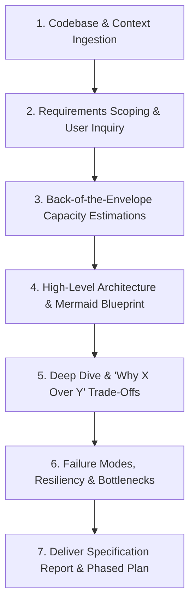

# Expert System Design Skill

This skill transforms the agent into a Principal Systems Architect. When invoked (e.g., *"run system design"*, *"design the system for this project"*, *"architect this service"*), it executes an end-to-end architectural evaluation grounded in the battle-tested principles of Alex Xu's *System Design Interview (Vol 1 & 2)* and high-scale production engineering.

---

## Operating Workflow

When this skill is executed, follow this 7-phase methodology:

---

### Phase 1: Codebase & Context Ingestion
1. **Discover Project Scope**: Read the root `README.md`, configuration files (`docker-compose.yml`, `pyproject.toml`, `package.json`), database models, and API route definitions.
2. **Identify Existing Constraints**: Map out the existing programming languages, frameworks, databases, and dependencies already in use.
3. **Locate Hotspots**: Inspect current data schemas and query patterns to detect potential architectural bottlenecks or single points of failure (SPOFs).

---

### Phase 2: Requirements Clarification & Interactive Scoping
Before proposing solutions, establish boundaries using the [4-Step Framework](./references/framework.md).

1. **Classify Requirements**:
   - **Functional Requirements**: Core user/agent capabilities (e.g., "submit blueprint", "rate limit requests", "deduplicate proposals").
   - **Non-Functional Requirements**: Latency targets (P95/P99), availability SLA (e.g., 99.95%), consistency guarantees (CP vs. AP), durability, and security.
   - **Out-of-Scope Non-Goals**: Explicit boundaries of what will *not* be built in v1.
2. **Clarify Underspecified Points with the User**:
   - If traffic, SLA, or business priorities are ambiguous, ask clarifying questions using `ask_question` or direct interactive prompts based on the [Interview Questions Guide](./resources/interview-questions.md).

---

### Phase 3: Back-of-the-Envelope Capacity Estimations
Using the [Estimation Cheatsheet](./references/estimation-cheatsheet.md), calculate and document quantitative sizing:

1. **Throughput (QPS)**:
   - Calculate Average QPS = $(\text{DAU} \times \text{Requests/Day}) / 86,400$.
   - Calculate Peak QPS = $\text{Average QPS} \times 2$ (or $3\text{--}5\times$ for bursty workloads).
   - Divide into Read QPS vs. Write QPS based on workload characteristics.
2. **Storage Sizing**:
   - Daily Ingestion = $\text{Daily Writes} \times \text{Record Size}$.
   - 5-Year Storage = $\text{Daily Ingestion} \times 365 \times 5 \times 1.2$ (accounting for indices and metadata overhead).
3. **Memory & Cache RAM Sizing**:
   - Apply the **80/20 Pareto Rule**: Cache 20% of daily read data volume in memory.
4. **Network Bandwidth**:
   - Calculate Ingress and Egress throughput in Megabits per second (Mbps).
5. **Hardware Server Counts**:
   - Estimate the minimum number of application workers, database instances, and cache nodes needed to support peak load.

---

### Phase 4: High-Level Architecture & Mermaid Blueprint
Synthesize the architectural components using proven patterns from [Architectural Patterns & Components](./references/patterns-and-components.md):

1. **Visual Blueprint**: Construct a clear Mermaid flowchart or sequence diagram depicting:
   - Ingress / DNS / CDN edge layer.
   - API Gateway / Reverse Proxy with rate limiting.
   - Stateless Application Tier (microservices or modular monolith).
   - In-Memory Cache (Redis cluster).
   - Primary Relational / Document Store with Read Replicas.
   - Asynchronous Message Broker (Kafka / RabbitMQ) and Background Workers.
2. **Data Model & Schema**:
   - Specify concrete SQL DDL or NoSQL document schemas, primary keys, foreign keys, and indices.
   - Define sharding keys and partitioning strategies if scaling horizontally.

---

### Phase 5: Deep Dive & "Why X Over Y" Trade-Offs
Consult the [Trade-Offs Catalog](./references/tradeoffs-catalog.md) to defend every key technological choice:

1. **Storage Choice**: Defend SQL (PostgreSQL) vs. NoSQL (MongoDB/Cassandra) vs. Vector DB (`pgvector`/Qdrant).
2. **Communication Protocols**: Defend REST vs. gRPC vs. WebSockets vs. Server-Sent Events (SSE).
3. **Concurrency & Locking**: Defend Optimistic locking vs. Pessimistic locking vs. Distributed Redis locks, along with idempotency key enforcement.
4. **Ingestion & Fanout**: Defend Fanout-on-Write (push) vs. Fanout-on-Read (pull) vs. Hybrid approach.
5. **Consistency Models**: Defend Strong Consistency (Quorum $W + R > N$, 2PC) vs. Eventual Consistency (Saga pattern).

---

### Phase 6: Failure Modes, Resiliency & Bottlenecks
Analyze how the system survives real-world failures:

1. **Single Points of Failure (SPOF)**: Eliminate single points of failure across every layer.
2. **Cache Collapse**: Guard against Cache Avalanche (randomized TTL jitter), Cache Penetration (Bloom filters / null caching), and Thundering Herd (mutex locks).
3. **Database Failover**: Specify automated replica promotion and data synchronization protocols.
4. **Network Partitions & Degradation**: Introduce Circuit Breakers (trip after threshold failures, return degraded cached responses) and adaptive Rate Limiters.

---

### Phase 7: Deliver Specification Report & Phased Plan
1. Structure the output according to the [System Design Report Template](./resources/system-design-report-template.md).
2. Present a clear **Phased Implementation Roadmap**:
   - **Phase 1: MVP & Core Backbone** (Entities, basic CRUD, core contracts).
   - **Phase 2: Scale & Performance Hardening** (Caching, async workers, read replicas).
   - **Phase 3: Production Readiness & Observability** (Tracing, metrics, disaster recovery drills).

---

## Reference Library

- [The 4-Step System Design Framework](./references/framework.md)
- [Back-of-the-Envelope Estimation Cheatsheet](./references/estimation-cheatsheet.md)
- [Architectural Patterns & Components Reference](./references/patterns-and-components.md)
- [System Design Trade-Offs Catalog ("Why X Over Y")](./references/tradeoffs-catalog.md)
- [Interactive Interview Questionnaire](./resources/interview-questions.md)
- [System Design Specification Report Template](./resources/system-design-report-template.md)
