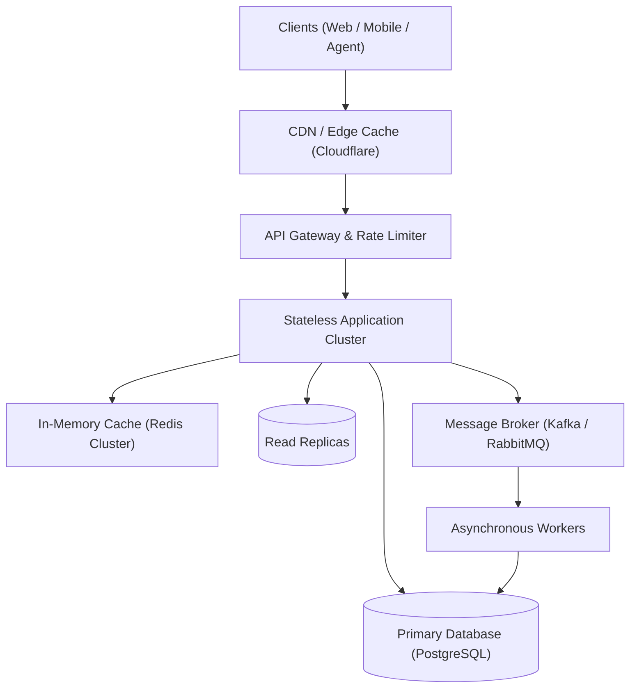

# System Design Specification: [System / Project Name]

**Status**: [Proposed | Under Review | Approved]  
**Author**: Antigravity System Design Engine  
**Target Scale**: [e.g., 100k DAU / 10M DAU]  
**Primary SLA**: [e.g., 99.9% Uptime, P95 Read < 50ms, P95 Write < 150ms]

---

## 1. Executive Summary & Context
*Provide a concise 2–3 paragraph overview of the problem, the business objective, and how this architecture addresses it.*

---

## 2. Requirements & Boundary Definition

### 2.1 Functional Requirements (Core Capabilities)
- [FR-1] ...
- [FR-2] ...
- [FR-3] ...

### 2.2 Non-Functional Requirements (Qualities of Service)
- **Availability**: [e.g., 99.95% (< 4.38 hours downtime/year)]
- **Latency**: [e.g., Read P99 < 80ms, Write P99 < 250ms]
- **Consistency**: [e.g., Strong consistency for orders, Eventual consistency for search feed]
- **Data Durability**: [e.g., Zero financial data loss; multi-region replication]

### 2.3 Explicit Non-Goals (Out of Scope for v1)
- [NG-1] ...
- [NG-2] ...

---

## 3. Back-of-the-Envelope Capacity Estimations

| Metric | Calculation | Estimated Value |
| :--- | :--- | :--- |
| **Daily Active Users (DAU)** | Baseline projection | `X` users |
| **Read QPS (Average / Peak)** | `(DAU * Reads/day) / 86,400` | `X` QPS avg / `Y` QPS peak |
| **Write QPS (Average / Peak)** | `(DAU * Writes/day) / 86,400` | `X` QPS avg / `Y` QPS peak |
| **Daily Data Ingestion** | `Daily Writes * Record Size` | `X` GB / day |
| **5-Year Storage Requirement** | `Daily Ingestion * 365 * 5 * 1.2` | `X` TB (with indices) |
| **Cache RAM Sizing** | 20% of daily read volume (80/20 rule) | `X` GB RAM |
| **Network Bandwidth (Egress)** | `Peak Read QPS * Response Size` | `X` Mbps |

---

## 4. High-Level Architecture



### Component Roles & Responsibilities:
1. **Edge / CDN**: Caches static assets, terminates TLS, and enforces DDoS mitigations.
2. **API Gateway**: Authentication, distributed token-bucket rate limiting, request routing, and metric telemetry.
3. **Application Tier**: Stateless workers processing business logic with horizontal autoscaling.
4. **Caching Layer**: Redis cluster providing sub-millisecond query lookups for hot data.
5. **Persistent Store**: Relational or document store with automated failover and read replicas.
6. **Async Processing**: Message queue decoupling long-running jobs (indexing, notifications, transcoding).

---

## 5. Data Model & Storage Design

### Core Schema Definition:
```sql
-- DDL definition of primary entities
CREATE TABLE resources (
    id UUID PRIMARY KEY,
    name VARCHAR(255) NOT NULL,
    version INT NOT NULL DEFAULT 1,
    metadata JSONB,
    created_at TIMESTAMPTZ DEFAULT NOW()
);
```

### Indexing & Sharding Strategy:
- **Primary Sharding Key**: `user_id` or `workspace_id` (ensures uniform distribution without hotspots).
- **Secondary Indices**: B-Tree indices on foreign keys, composite index on `(status, created_at DESC)`.

---

## 6. Deep Dive: Architectural Trade-Off Decisions ("Why X Over Y")

### 6.1 Storage Selection: [Choice A] vs. [Choice B]
- **Selected**: `[e.g., PostgreSQL + pgvector]`
- **Alternative Considered**: `[e.g., MongoDB + Pinecone]`
- **Rationale**:
  - *Why Selected*: ...
  - *Trade-off Accepted*: ...

### 6.2 Communication Protocol: [Choice A] vs. [Choice B]
- **Selected**: `[e.g., REST + SSE]`
- **Alternative Considered**: `[e.g., WebSockets]`
- **Rationale**:
  - *Why Selected*: ...
  - *Trade-off Accepted*: ...

### 6.3 Concurrency & Idempotency
- Concurrency strategy (e.g., Optimistic locking with version counters vs Pessimistic locks).
- Distributed idempotency key check pattern.

---

## 7. Failure Modes, Resiliency & Bottlenecks

| Potential Failure Mode | Impact | Mitigation / Recovery Mechanism |
| :--- | :--- | :--- |
| **Primary DB Crash** | Write outage | Automated health check fails over to standby replica within 30 seconds; promotions handled via consensus. |
| **Cache Node Outage** | Cache miss storm | Consistent hashing redistributes keys across surviving nodes; circuit breaker throttles DB queries. |
| **Sudden Traffic Spike (10x)** | Server CPU saturation | Stateless tier autoscales based on CPU/concurrency metrics; rate limiter throttles non-essential traffic. |
| **Third-Party Service Timeout** | Thread pool starvation | Circuit breaker (Resilience4j / Tenacity) opens after 5 failures; returns degraded fallback response. |

---

## 8. Phased Implementation Roadmap

### Phase 1: MVP & Core Backbone (Weeks 1–2)
- [ ] Database schema migrations and ORM models.
- [ ] Core CRUD endpoints with strict schema validation.
- [ ] Basic rate limiting and authentication middleware.

### Phase 2: Performance & Scalability Hardening (Weeks 3–4)
- [ ] Redis caching layer with cache-aside pattern.
- [ ] Message queue integration for asynchronous workflows.
- [ ] Read replica routing and query optimization.

### Phase 3: Observability & Production Readiness (Weeks 5–6)
- [ ] Prometheus metrics and OpenTelemetry tracing instrumentation.
- [ ] Automated backup & disaster recovery drill.
- [ ] Load testing up to 2x peak estimated QPS.
