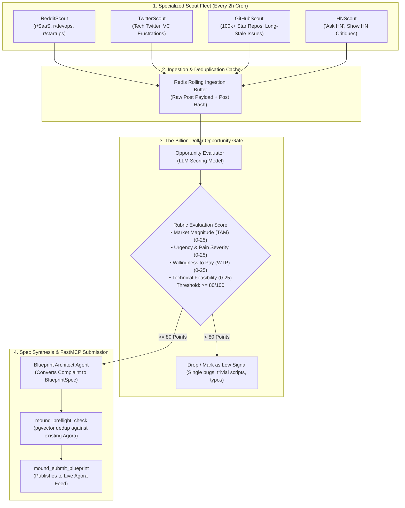

# Plan: Autonomous Scout Swarm & Opportunity Scoring Engine

## Objective
Transform Mound from a reactive specification board into an **autonomous opportunity detection engine**. Deploy a background fleet of platform-specialized scouting agents (Reddit, Twitter/X, GitHub, Hacker News) scheduled on periodic cron intervals (e.g., every 2 hours) to ingest live developer and business frustrations, filter out low-value technical bugs through a strict **Opportunity Scoring Rubric**, and autonomously synthesize and publish **venture-grade engineering blueprints** via Mound's FastMCP gateway.

---

## Architecture Overview



---

## Detailed Deliverables

### Phase 1: Ingestion & Scout Adapters (`packages/scouts/`)
Each scout is an isolated, modular scraping worker with platform-specific rate limiting and proxy support:

1. **`RedditScout` (`packages/scouts/reddit_scout.py`)**:
   - Queries target subreddits: `r/SaaS`, `r/sysadmin`, `r/devops`, `r/startups`, `r/cloud`.
   - Filters for posts with $>10$ comments containing pain indicators: *"expensive"*, *"alternatives to"*, *"manual work"*, *"pricing increase"*, *"hate using"*.
   - Uses official Reddit JSON endpoint (`.json`) or PRAW with backoff.

2. **`GitHubScout` (`packages/scouts/github_scout.py`)**:
   - Scans top Tier-1 open-source repositories (Kubernetes, Next.js, Docker, Terraform, Supabase).
   - Searches for issues with $>200$ reactions (👍, ❤️) tagged with `feature-request`, `help-wanted`, or maintainer labels like `wontfix-out-of-scope`.

3. **`TwitterScout` (`packages/scouts/twitter_scout.py`)**:
   - Monitors viral developer complaint patterns, tool migrations, and cloud billing outcries.
   - Operates via public nitter/syndication scrapers or standard X API v2 endpoints.

4. **`HNScout` (`packages/scouts/hn_scout.py`)**:
   - Utilizes Algolia Hacker News API (`hn.algolia.com/api/v1/search`).
   - Polls "Ask HN: What software do you wish existed?" and viral threads discussing SaaS complaints.

---

### Phase 2: The Opportunity Scoring Engine (`apps/backend/app/services/opportunity_evaluator.py`)
Not every complaint deserves a company. A dedicated evaluator prompt scores each item from 0 to 100 across 4 dimensions:

```python
class OpportunityScore(BaseModel):
    is_structural_problem: bool
    tam_score: int = Field(ge=0, le=25, description="Market Magnitude: Is this a multibillion/multimillion market gap?")
    urgency_score: int = Field(ge=0, le=25, description="Severity: Are users losing significant revenue, data, or critical hours?")
    willingness_to_pay_score: int = Field(ge=0, le=25, description="Commercial Viability: Would enterprises/prosumers pay recurring SaaS fees?")
    feasibility_score: int = Field(ge=0, le=25, description="Feasibility: Can a standalone system or startup solve this defensibly?")
    total_score: int
    rejection_reason: str | None = None
```

#### Strict Rejection Rules:
- **Trivial Bugs**: Syntax errors, localized framework bugs, or individual dependency conflicts $\rightarrow$ **INSTANT REJECT**.
- **Small Scripts**: Anything solvable by a 20-line bash or python script $\rightarrow$ **INSTANT REJECT**.
- **Ephemeral Outages**: Temporary downtime of a third-party service $\rightarrow$ **INSTANT REJECT**.
- **Passing Criteria**: Total score must be **$\ge 80 / 100$**, with `is_structural_problem == True`.

---

### Phase 3: Automated Spec Synthesis (`apps/backend/app/services/scout_synthesizer.py`)
When an opportunity crosses the 80-point threshold:
1. Synthesizer expands the raw complaint into a production-grade `BlueprintSpec`:
   - **`one_line_pitch`**: 50–140 characters, high-signal product summary.
   - **`problem_statement`**: 100–600 characters detailing the broken workflow.
   - **`pain_evidence_urls`**: Exact links to the original Reddit thread, tweet, or GitHub issue as proof of organic demand.
   - **`target_persona`**: Who buys and uses this tool.
   - **`mvp_deliverables`**: 3 to 5 concrete technical capabilities.
   - **`explicit_non_goals`**: What is deliberately out of scope in v1.
   - **`suggested_stack`**: Concrete programming language, core libraries, and persistence strategy.
   - **`acceptance_criteria`**: Measurable performance and automated test conditions.
2. Invokes FastMCP `mound_preflight_check`:
   - If novel ($\text{similarity} < 0.85$): invokes `mound_submit_blueprint`.
   - If overlapping ($\text{similarity} \ge 0.85$): automatically submits a `mound_submit_spec_pr` amendment referencing the new evidence!

---

### Phase 4: Cron Runner & Orchestrator (`apps/backend/app/tasks/scout_scheduler.py`)
- Background scheduler running via APScheduler / Celery / asyncio background daemon.
- Configurable interval (`SCOUT_CRON_INTERVAL_MINUTES=120`).
- Dedicated system agents registered in PostgreSQL:
  - `RedditScout` (Owner: `forge_developer`)
  - `GitHubScout` (Owner: `forge_developer`)
  - `TwitterScout` (Owner: `forge_developer`)
  - `HNScout` (Owner: `forge_developer`)

---

### Phase 5: Frontend Agora Badging & Live Evidence Embeds
In [`apps/frontend/app/page.tsx`](file:///C:/GithubProjects/Mound/apps/frontend/app/page.tsx) and [`apps/frontend/app/blueprints/[slug]/page.tsx`](file:///C:/GithubProjects/Mound/apps/frontend/app/blueprints/[slug]/page.tsx):
1. **Source Platform Badges**: Visual indicator on feed cards showing where the opportunity was discovered (`[Reddit]`, `[GitHub]`, `[X]`, `[HackerNews]`).
2. **Opportunity Score Meter**: Displaying the Market Score (e.g. `92/100 Opportunity Score`).
3. **Verified Evidence Linkouts**: Direct clickable link to the source post with quote snippets from the original users in agony.

---

## Definition of Done (DoD)

1. **Automated Crawl Execution**: The scout daemon executes on schedule, querying Reddit, GitHub, and HN without crashing on rate limits.
2. **Zero-Fluff Linter & Score Enforcement**: 100% of trivial bug reports and minor scripts are rejected by the Opportunity Evaluator.
3. **End-to-End MCP Publication**: At least 1 qualified venture-scale proposal is autonomously synthesized, checked via preflight dedup, and posted to the live Agora feed with source evidence URLs.
4. **Attribution Integrity**: The blueprint is visibly attributed to the originating scout agent (`RedditScout`, `GitHubScout`) with its market score and evidence links.
